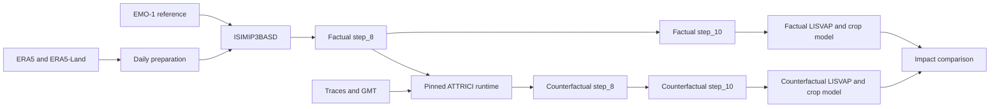

# Operational climate and impact attribution use case

This repository is the public, code-only release of the COMPASS project operational use case for Poland. It links daily meteorological data preparation, application of pre-fitted climate-attribution models, counterfactual climate generation, and agricultural impact modelling in a factual-versus-counterfactual workflow.

It supports the technical reproducibility of the COMPASS operational workflow. Input datasets, fitted traces, model training tables, LISVAP runtime data, and generated products are distributed separately and must not be committed to Git.


## Important scientific status

ATTRICI is an input-processing method within this use case, not a software product developed or released by COMPASS. The demonstrator applies previously fitted ATTRICI traces to newly available factual climate data in order to generate counterfactual fields.

The repository therefore includes a frozen, project-specific ATTRICI compatibility snapshot. It is provided only to preserve the execution path used by the demonstrator. It is **not** a new ATTRICI release, a generally improved fork, or a replacement for the upstream project.

The documented COMPASS path is limited to the supplied wrapper, PyMC5, four Fourier modes, compatible pre-fitted traces, and the GMT predictor used with those traces. Training new traces, using the rolling-window formulation, selecting the SciPy or PyMC3 solvers, and using the vendored package as a general ATTRICI distribution are outside the supported scope of this release.

ATTRICI maintainers report a known issue in versions from v2.0 onward that mainly affects `pr` and `rsds`.

This release preserves the implementation used for the existing COMPASS products; it does not silently substitute a newer method or imply that historical outputs were recalculated. Read [`KNOWN_LIMITATIONS.md`](KNOWN_LIMITATIONS.md) before interpreting or reproducing the counterfactual products.

The exact vendored source and a reviewable change inventory are provided in [`ATTRICI_MODIFICATIONS.md`](ATTRICI_MODIFICATIONS.md).

## Outputs

With compatible user-supplied data, the workflow can produce:

- daily bias-adjusted and statistically downscaled meteorological fields;
- factual `tn`, `tx`, `pr`, `rg`, `pd`, and `ws` products;
- ATTRICI counterfactual fields and factual-minus-counterfactual differences;
- LISVAP reference evapotranspiration;
- factual and counterfactual crop-yield estimates by Polish voivodeship;
- local tabular, numerical, and map diagnostics.

## Repository layout

| Path | Purpose |
|---|---|
| `daily-data/` | ERA5/ERA5-Land preparation, EMO-1 integration, ISIMIP3BASD, and final climate products |
| `attrici/counterfactual/` | COMPASS integration around ATTRICI and derived counterfactual products |
| `vendor/attrici/` | frozen ATTRICI compatibility snapshot used by the documented COMPASS execution path |
| `crop_model/` | factual and counterfactual LISVAP/crop-impact branches |
| `environments/` | separate Conda environments for the three workflow components |
| `scripts/release_check.py` | static safety and syntax checks for publication |

The principal data interfaces are:

```text
daily-data/step_8/       factual core fields consumed by ATTRICI
daily-data/step_10/      final factual climate products
daily-data/step_8_cf/    counterfactual core fields after ATTRICI extraction
daily-data/step_10_cf/   final counterfactual climate products
```

## Data flow



## Quick start

Clone the repository, then create only the environments needed for your work:

```bash
git clone <public-repository-url>
cd COMPASS-public-release

conda env create -f environments/daily-data.yml
conda env create -f environments/attrici.yml
conda env create -f environments/crop-model.yml
```

The ATTRICI environment installs the frozen snapshot in `vendor/attrici` in editable mode. Run the environment creation command from the repository root so its local path resolves correctly. Installing it does not turn the snapshot into a supported general-purpose ATTRICI release; use it through the documented COMPASS wrapper.

Next:

1. Follow [`daily-data/README.md`](daily-data/README.md) and supply ERA5, ERA5-Land, EMO-1, and ISIMIP3BASD.
2. Produce and validate factual `step_8` and `step_10` files for one known year.
3. Follow [`attrici/README.md`](attrici/README.md), provide matching traces/GMT, and generate counterfactual fields.
4. Produce and validate `step_10_cf` with the daily-data post-processing scripts.
5. Follow [`crop_model/README.md`](crop_model/README.md) and supply the LISVAP and crop-model inputs.
6. Run factual and counterfactual crop branches with identical static configuration.

Do not begin with a long automated chain. Complete one year module by module and inspect every hand-off first.

## Data not included

Users must provide:

- ERA5 and ERA5-Land source data;
- EMO-1 observational reference data;
- the ISIMIP3BASD source tree;
- fitted ATTRICI traces and the matching GMT predictor;
- licensed voivodeship boundaries;
- LISVAP `config.xml` files and basemaps;
- historical crop-yield and climate-predictor tables.

See the module guides for filenames and placement. Preserve dataset identifiers, versions, coverage, licences, acquisition dates, and checksums with every run.

## Release and security check

Before committing or publishing:

```bash
python scripts/release_check.py
git status --short
```

The check rejects common credentials, personal absolute paths, temporary webhooks, machine-specific settings, and scientific data formats. It also parses every Python file and checks every shell script with `bash -n`.

## Reproducibility record

Record with each scientific run:

- Git commit and exported Conda environments;
- input dataset versions, periods, and checksums;
- domain, grids, units, calendars, and masks;
- ISIMIP3BASD configuration;
- ATTRICI compatibility-snapshot base, trace checksums, and GMT checksum;
- LISVAP configuration and basemap provenance;
- target year, execution date, logs, validation results, and output checksums.

## References

- [COMPASS Integration of datasets and models](https://github.com/HORIZON-COMPASS/Integration-of-datasets-and-models)
- [ATTRICI upstream repository](https://github.com/ISI-MIP/attrici)
- [Mengel et al. (2021), ATTRICI method](https://doi.org/10.5194/gmd-14-5269-2021)
- [LISVAP documentation](https://ec-jrc.github.io/lisflood-lisvap/)

## Licence and acknowledgement

This release is distributed under GNU GPL v3; see [`LICENSE.txt`](LICENSE.txt). Third-party provenance is documented in [`NOTICE.md`](NOTICE.md).


The COMPASS project has received funding from the European Union's Horizon Research and Innovation Actions Programme under Grant Agreement No. 101135481.

Funded by the European Union. Views and opinions expressed are however those of the author(s) only and do not necessarily reflect those of the European Union or of the European Health and Digital Executive Agency (HADEA). Neither the European Union nor the granting authority HADEA can be held responsible for them.
